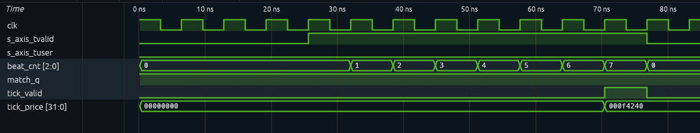

# udp-feed-handler

A cut-through UDP market-data feed handler for a 10G Ethernet FPGA datapath, in
SystemVerilog, verified with cocotb. This is the first stage of a larger project
and is still in progress (see next steps).

## What it does

It sits directly behind a 10G Ethernet MAC (64-bit AXI4-Stream at 156.25 MHz:
the 10 Gb/s serial stream arrives as one 8-byte beat every 6.4 ns) and watches every
frame. Frames that are IPv4/UDP packets to the configured multicast group and port
carry a 14-byte quote message; the handler decodes it and emits a tick (side,
instrument, price, quantity) one clock cycle after the last message byte arrives,
without waiting for the end-of-frame checksum. If the MAC then reports a bad FCS,
the tick is cancelled.

## Design

| Beat | Frame bytes | Checked or used |
|---|---|---|
| 0 | 0–7 | nothing (MAC addresses, already filtered by the MAC) |
| 1 | 8–15 | EtherType = `0x0800` (IPv4), version/header length = `0x45` (no IP options) |
| 2 | 16–23 | not a fragment (MF = 0, offset = 0, DF ignored), protocol = UDP |
| 3 | 24–31 | destination IP, top half |
| 4 | 32–39 | destination IP, bottom half; destination port; UDP length ≥ 22 |
| 5 | 40–47 | message type = 'Q', side = 'B' or 'S'; instrument captured |
| 6 | 48–55 | price and quantity → tick |
| 7+ | 56+ | wait for the last beat; cancel if the FCS was bad |

- **Check in flight:** each beat is checked as it passes; one flip-flop (`match_q`) records whether every check so far passed, so the header is never stored.
- **Beat counter:** 3 bits, counts valid beats only and stops at 7, so idle cycles and long frames can't confuse it.
- **Cut-through:** the tick is registered on the edge that captures beat 6; a bad FCS on the last beat gives `tick_cancel`, and if it arrives on beat 6 itself the tick is never sent.
- **Storage:** the bus is only split into named byte lanes (wires); all state is in flip-flops, no block RAM.

## Verification

17 cocotb tests (cocotb drives the simulator from Python):

- **Fake MAC** cuts each frame into 8-byte beats and drives the AXI4-Stream inputs, with optional random idle cycles.
- **Monitor** records every tick and cancel, which frame caused it, and its latency in cycles.
- **Real frames** are built with Scapy, so the Ethernet/IPv4/UDP headers are exactly what a network card would produce.

Directed tests per feature (beat counter, ten reject cases, field decoding, cancel and
suppression paths, truncated frames), exact latency, 500 back-to-back frames at full
line rate, and 2,000 random frames with random idle cycles checked against a Python
reference model. Waveforms checked in Surfer.

   

## Results

From simulation (latency) and Yosys synthesis (resources).

| Metric | Value |
|---|---|
| Latency, first beat to tick (no idle cycles) | 7 cycles (44.8 ns at 156.25 MHz) |
| Latency, last message byte to tick | 1 cycle |
| LUTs (Yosys, UltraScale+) | 71 (+1 inverter) |
| Carry cells | 2 CARRY4 (beat counter +1, UDP length ≥ 22 compare) |
| Flip-flops | 137 (136 FDRE + 1 FDSE for match_q, which resets to 1) |
| Critical path | 3 LUT levels |

## Limitations and next steps

One message per packet at a fixed offset; no VLAN or IP options; no sequence numbers.
Next: best bid and ask per instrument, sequence-gap detection, multiple
messages per packet.

## Running it

```sh
make test                # all tests (Verilator)
make test GROUP=filter   # one group: reset, counter, filter, decode, fcs, perf, random
make test SIM=icarus     # same tests on Icarus Verilog
make test WAVES=1        # dump waveforms, open with: surfer tb/dump.vcd
                         # (run make clean first when switching WAVES on or off)
make lint                # strict Verilator lint
make synth               # Yosys synthesis: resources + critical path
```